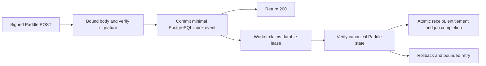

# Durable Paddle sandbox webhooks

Baseline: `b3ff23c`. Date: 2026-10-16. This replaces the synchronous webhook
architecture described in the [Phase 8 verification report](saas-monetization-phase-8-verification.md).
It does **not** establish genuine Paddle acceptance or production readiness.
All payment/entitlement, linking and MCP feature flags remain disabled.

## Audit and design

The previous public webhook route verified the raw signature and then awaited
`processEvent()`. That opened a billing transaction, locked the account and called
multiple Paddle endpoints (including paginated adjustments) before returning 200.
Per-request API timeouts did not bound the combined HTTP request. Paddle requires
an acknowledgment within five seconds and retries non-200/late responses. See the
[official delivery and retry guidance](https://developer.paddle.com/webhooks/about/respond-to-webhooks/).

The route now performs only bounded raw-body verification and a durable inbox
transaction. Provider reconciliation runs in a separately invoked process. There
is no Next.js background promise, in-memory queue, external paid queue or automatic
scheduler registration.



### Ingress bounds and acknowledgment

- Raw body: maximum 256 KiB and one-second read deadline. Cancellation is not
  awaited, so a stalled stream/cancellation cannot retain the request indefinitely.
  Old/future signatures, malformed envelopes and signature forgery are rejected
  before storage. Verified objects are frozen and branded inside the verifier;
  inbox ingestion rejects arbitrary objects even if they resemble an event.
- Separate ingress pool: maximum two connections, 250 ms acquisition/connection
  deadline, 750 ms query/server statement timeout. It reuses the website's existing
  reviewed DB connection/IPv4 options, without competing for matching pool slots.
  Budget these extra connections per application instance before deploying.
- Ingress transaction: 1.5-second cumulative query deadline, 250 ms lock timeout,
  two-second idle transaction timeout, `synchronous_commit=on`. It acknowledges
  only after confirmed COMMIT. Failure or an uncertain commit returns 503 and
  destroys the connection; provider redelivery safely finds the committed event
  if COMMIT actually succeeded. No automatic transaction retry is introduced.
- Event ID is the inbox primary key. A fingerprint of normalized minimal fields
  detects conflicting reuse of an event ID; existing matching deliveries return
  200 without resetting state or retries. A short transaction advisory lock
  serializes capacity checks; its wait is bounded by the SQL lock timeout.
- Only event type, occurrence time, entity IDs, optional subscription/transaction
  lookup IDs and a valid opaque intent UUID are retained, plus worker metadata.
  No raw JSON, headers, signature, secret, email, customer attributes or arbitrary
  `custom_data` is stored. Unsupported signed event types are durably `ignored`,
  with their data fields stripped; they are never sent to provider processing.
- Total retained inbox capacity is 10,000 records, including terminal records.
  At capacity, known duplicates still acknowledge; new events return 503. This
  is an explicit sandbox storage bound, not permission to discard unprocessed
  events. See maintenance below before enabling any destination.

These bounds remove provider latency from the HTTP path. They do not guarantee
five-second delivery under arbitrary process pauses, cold starts or unavailable
DB/network conditions. Those cases fail closed or produce provider retries;
genuine staging latency measurements are still required.

### Worker transactions and fencing

Migration **011** adds only the inbox table and indexes. Existing migrations
004–010 are unchanged. It has no user FK or entitlement trigger/backfill; retaining
minimal event/dedup metadata does not recreate a deleted account. Only disposable
test databases received migrations in this task.

`scripts/process-paddle-sandbox-webhooks.ts` runs one pass, default five jobs,
internal maximum ten. It reuses the existing isolated sandbox worker connection
guard, canonical API adapter, billing state projection, entitlement writer and
`billing_events` processed-event ledger.

1. Claim in a short transaction with `FOR UPDATE SKIP LOCKED`. Increment the
   attempt before work and commit a fresh random token with a 60-second lease.
2. In a new transaction, lock the inbox row and require the current token and an
   unexpired lease. Worker callbacks reconstruct only the stored hint envelope;
   old signature timestamps are not reverified after a valid durable receipt.
3. Call `processEventInTransaction()` using **that same client**. Its processed
   receipt, canonical billing state and entitlement mutation commit with job
   completion. Account locks retain the existing order: inbox row, processed-event
   receipt, website user, billing row. Manual/periodic reconciliation uses the same
   user-before-billing order and does not acquire inbox locks.
4. Provider requests retain three-second per-call deadlines and existing bounded
   pagination. A shared 25-second abort signal spans all calls in a job. Worker SQL
   uses one-second lock, five-second statement, six-second client query and
   35-second idle-transaction bounds. Deadline/lease checks before publication
   reject late work and roll back prepared grants. The actual worker callback
   honors the abort signal; no abandoned `Promise.race` continues writing after
   the worker has declared failure.
5. Finish only while the token and lease remain current. A second worker cannot
   process the same locked row; a stale token cannot publish or reschedule a new
   worker's claim. Lease expiry while work is in progress causes rollback.

A crash after claiming but before work leaves a reclaimable lease. A backend
termination after prepared entitlement writes rolls back those writes and the
processed receipt. A successful commit whose response is lost leaves job `done`
and its receipt intact; failure handling cannot regress it to pending. Redelivery
and recovery never clear that receipt or reset monthly usage.

Failures use independent conditional retry bookkeeping after the business
transaction rolls back/disconnects. Backoffs are 60 seconds, five minutes,
30 minutes, then one hour; attempt five becomes terminal `failed`. Duplicate
notifications do not reset attempts. Expired final-attempt leases become terminal
failure through a separate bounded sweep (up to ten per claim). If retry bookkeeping
itself cannot commit, the lease remains recoverable; startup/DB failures emit only
redacted status and return nonzero. No raw database/provider errors are persisted.

Canonical relationship checks, paid-through dates, sticky per-payment refunds,
payment and subscription watermarks and account isolation are unchanged. A new
queued event alone never grants Pro. Unsupported mappings cannot assign another
user's subscription. Delayed events fetch current provider state; event contents
and arrival order do not supply entitlement state.

### Latency and periodic reconciliation

The existing bounded periodic reconciliation worker remains separate and opt-in.
Both paths use the same canonical reconciliation/writer, locks and watermark
policy. A successful event reconciliation resets the account's periodic retry
metadata as before. Neither worker silently enables the other.

Revocation is asynchronous: an accepted notification is queued, not yet verified
as a refund. Backlog, provider outages or dead-letter failures can retain the
previously verified paid-through state until successful canonical reconciliation
or clock expiration. No failure extends that period or creates a new grant.
Operator monitoring, manual authenticated refresh and the entitlement kill switch
remain necessary. While a job holds an account lock during API reads, matching
for that account may reach its existing five-second lock timeout; it fails without
consuming a unit. This safety/availability tradeoff is retained, not hidden by a
longer timeout or an outcome-uncertain matching retry.

## Operating prerequisites and rollout

**BLOCKED for real staging/provider verification:** staging HTTPS origin, separate
sandbox DB URL, API key, webhook secret, client token and price ID are absent in
runtime/environment-file presence checks. No values were printed. The existing
website DB's isolation is unconfirmed and it was never connected to or modified.
No provider requests, notification registration, migration, scheduling, feature
activation or deployment were performed against staging/production.

Before enabling a sandbox destination:

1. Explicitly confirm an isolated staging website/database. Review/apply 001–011
   there with an authorized migration operator; the website and both workers must
   refer to that same database. Deploy schema before the new webhook route.
   Missing inbox schema returns 503 instead of acknowledging lost work.
2. Configure existing sandbox-only credentials privately and follow the genuine
   [Phase 8 acceptance checklist](saas-monetization-phase-8.md). The new worker
   requires `PADDLE_WEBHOOK_WORKER_ENABLED=true`, `PADDLE_SANDBOX_ENABLED=true`,
   valid sandbox deployment configuration and `PADDLE_SANDBOX_DATABASE_URL`.
   Entitlement activation remains a separate default-false flag.
3. The initial worker supports only the existing private `/tmp` Unix socket,
   explicit user and `paddle_sandbox_*` DB name guard, plus an actual database-name
   check. No website `DATABASE_URL` fallback, remote/TCP URL, `.env` loading or live
   API host exists. Hosted staging connectivity needs a separately reviewed
   connection mechanism; do not weaken the guard to reach production.
4. Run one bounded pass manually, then arrange an external scheduler only after
   reviewing staging evidence. Start with a 30–60 second polling target and a
   small enforced process concurrency limit (initially at most two). Jobs can
   outlast a scheduler tick; leases/locks support overlapping passes. Review
   throughput and DB connection budgets, rather than spawning unlimited workers.

```sh
# Export sandbox-only configuration privately; do not source the production .env.
node --conditions=react-server --import tsx scripts/process-paddle-sandbox-webhooks.ts
```

Output is aggregate JSON: operation, selected, done, retry, failed, skipped,
blocked, outstanding, oldest_seconds and durationMs. Exit 1 indicates startup/DB
failure, retries or any terminal blocked rows. Alert on nonzero exit, missing
runs, unexpected pending age (initial target under 60 seconds), backlog growth,
capacity approaching 10,000, signature/persistence failures and absent delivery.
A 200 response proves persistence, not Pro activation; check job state and the
canonical provider evidence independently.

### Retention and reviewed recovery

There is deliberately no automatic deletion or retry reset of failed jobs. A
staging operator must set an archival/retention and capacity policy before running
this long term. The compact processed `billing_events` ledger remains the final
idempotency record and must not be cleared to reclaim inbox space.

After backup/review, completed old inbox records may be removed in bounded batches
**only** where the matching `paddle_sandbox` processed receipt exists. Preserve the
receipt: a redelivery can then recreate a queued record, but the processed-event
check prevents any second entitlement mutation. Never delete pending/processing
or failed records as a capacity shortcut. Ignored-event retention and provider-ID
privacy policies require operator review too. Automatic archival is not installed
by this change, and the 10,000-record cap must be revisited before production.

For a terminal failure, inspect the private event ID, immutable hint mapping,
provider evidence and failure cause first. Correct the cause, then use a reviewed
single-event staging operation to move only that `failed` row to `pending`, reset
its attempts and finished/lease metadata, and make it due. Do not delete its
processed receipt or forge/change its payload. No public recovery endpoint or
automatic same-payment refund reversal exists.

## Quota acquisition-timeout investigation

The deterministic reproducer requests forty admissions from a cold pool while
stalling Node's event loop for 700 ms against the original 500 ms acquisition
budget. Expected pg acquisition timeouts occur **before a transaction can admit
work**. Tests classify those errors and verify at most three successful Free
admissions and an exact matching persisted counter; failed admissions do not
consume units. This is resource starvation, not evidence of a quota overrun,
wrong-account grant or incorrect rollback. No production timeout or quota was
relaxed and no automatic matching retry was added.

An additional PostgreSQL test holds all ten matching-pool connections, observes
redacted admission failure with zero usage, and successfully commits a signed
webhook through a separate two-connection ingress pool. After releasing matching
connections, exactly the Free budget remains usable. This verifies the reason for
pool isolation. The older intermittent incident's precise pg error still cannot
be retrospectively established; prior diagnostic instrumentation was absent.

## Verification evidence

| Check | Result |
| --- | --- |
| Complete top-level suite | PASS: 254/254 cases across 29 files, zero skipped |
| PostgreSQL billing/inbox suite | PASS: 40 cases, including 16 new durable-ingress/worker/isolation cases; part of the 254 total |
| TypeScript / ESLint / whitespace | PASS: `tsc --noEmit`, ESLint, `git diff --check` |
| Webpack production build | PASS: complete compile, type check, prerender and trace collection |
| Standard Turbopack build | ENVIRONMENT BLOCKED: internal subprocess port binding returned `Operation not permitted` |
| Seven browser regressions | PASS: public auth, onboarding, resume, application tracking, job analysis, job details and job search, fresh synthetic server/profile per script |
| Disabled-billing browser smoke | PASS: pricing, responsive widths, login guard, disabled billing/checkout; repeated against the final rebuilt artifact |
| Genuine provider/staging delivery and scheduled workers | BLOCKED / NOT TESTED: missing staging target and credentials |
| New production migration / deployment / payment activation | NOT PERFORMED, explicitly outside authorization |

The initial implementation TypeScript check rejected an inline `query_timeout`
configuration property; it was corrected to the supported pg query-options form,
confirmed against the installed pg implementation. Final TypeScript/build checks
pass. No automated test failures or skipped cases remain in the final run. The
historical quota incident remains unattributed, as described above.

Reproduce with local subprocess/socket access, Node 24 and PostgreSQL 16 server
binaries (this run extracted PostgreSQL 16.15 into `/tmp/webhook-postgres/root`,
without installing a package or service):

```sh
export PADDLE_TEST_POSTGRES_BIN=/path/to/postgresql/16/bin
export ACCOUNT_DELETION_TEST_POSTGRES_BIN="$PADDLE_TEST_POSTGRES_BIN"
export IDENTITY_LINKING_TEST_POSTGRES_BIN="$PADDLE_TEST_POSTGRES_BIN"
for file in tests/*.test.mjs; do
  node --test --test-isolation=none "$file" || exit 1
done
pnpm exec tsc --noEmit
pnpm lint
pnpm build
node node_modules/next/dist/bin/next build --webpack
node tests/browser/run-regressions.mjs
node tests/browser/paddle-sandbox-readiness.mjs
```

Run browsers after the build has finished; do not rebuild their active artifact
while a fixture server is running.

Tests use real disposable PostgreSQL 16.15 and synthetic provider responses, never
the website DB or genuine provider credentials. Coverage includes the actual
signed HTTP route to a committed inbox, forged signatures, PII stripping,
concurrent duplicates, conflicting event IDs, unsupported events, capacity and
lock limits, uncertain commits, concurrent workers, abandoned and expired leases,
actual backend termination after a prepared grant, retry exhaustion, deadlines,
deleted/cross-account users, delayed refund/activation events and periodic races.

Genuine Paddle delivery latency, real purchase/refund/dispute activation/revocation,
configured staging scheduling, cold-start load/SLO measurements, long-term archival
and hosted worker connectivity are **NOT TESTED**. They remain rollout blockers;
local test success does not make Phase 8 production ready. Production payments,
paid MCP quotas and Auth0 linking remain disabled. No push is performed.
